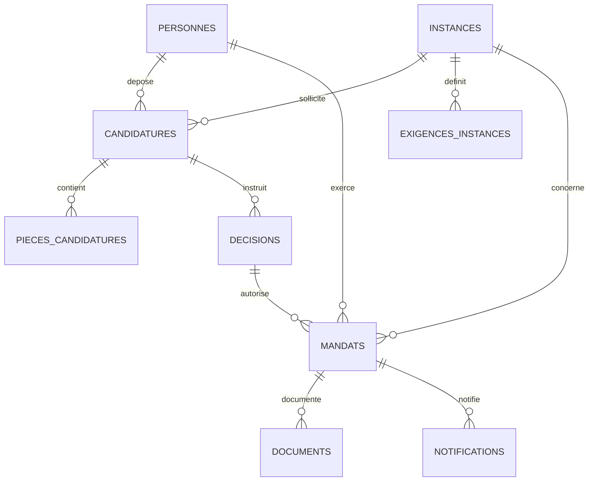

# CFTC Mandats Paritaires

**Cahier des charges fonctionnel et technique — application de coordination des mandats paritaires de l'Union Régionale CFTC Bretagne**

**Statut :** cahier des charges évolutif, version de travail 0.2 — 24 octobre 2026.  
**Maîtrise d'ouvrage :** Union Régionale CFTC Bretagne.  
**Référentiel de développement :** [GitHub UR-CFTC-Bretagne/cftc-mandats-paritaires](https://github.com/UR-CFTC-Bretagne/cftc-mandats-paritaires).  
**Pilotage :** backlog [GitHub Issues](https://github.com/UR-CFTC-Bretagne/cftc-mandats-paritaires/issues), développement itératif par Pull Requests.

> ⚠️ **Projet en cours de développement, non homologué pour la production.** Le dépôt GitHub est actuellement **public**. Il ne doit contenir **aucune candidature nominative, pièce de mandat, donnée confidentielle, export de fichier ou secret**. Le code de US-001 est proposé dans une [Pull Request en brouillon](https://github.com/UR-CFTC-Bretagne/cftc-mandats-paritaires/pull/14).

## 1. Contexte et finalité

L'UR CFTC Bretagne coordonne des représentants mandatés auprès de différentes instances paritaires, économiques et sociales. Le suivi des candidatures, des décisions, des désignations, des documents et des échéances nécessite un référentiel commun, une traçabilité des actions et des échanges cohérents avec les organisations et les instances.

L'application doit **sécuriser le cycle de vie d'un mandat**, depuis la candidature jusqu'à son terme, sans se substituer aux décisions des autorités compétentes.

### Objectifs

1. **Centraliser** les personnes, candidatures, instances, décisions et mandats.
2. **Fiabiliser** les données et détecter les dossiers incomplets et les doublons.
3. **Tracer** les vérifications, décisions, documents et notifications.
4. **Automatiser les préparations**, sans déclencher prématurément des désignations ou envois officiels.
5. **Anticiper** les échéances, renouvellements et besoins de représentation.
6. **Piloter** le réseau des mandatés par des indicateurs adaptés aux habilitations.
7. **Garantir** un logiciel modulaire, maintenable, documenté et évolutif.

## 2. Parties prenantes et utilisateurs

| Acteur | Rôle attendu | Droits envisagés |
| --- | --- | --- |
| Coordinateur du réseau des mandatés | Instruction et suivi des dossiers, préparation des documents, alertes | Gestion opérationnelle selon habilitation |
| Secrétariat / responsables de l'UR | Vérification des décisions, validation des actes | Validation et consultation autorisée |
| Conseil UR ou autorité compétente | Décision de mandatement selon les règles applicables | Décision attestée et justifiée |
| Mandaté ou candidat | Dépôt et suivi des informations, comptes rendus | Accès strictement limité à ses données autorisées |
| Syndicat et UD CFTC | Information et coordination territoriale | Consultation/notification selon habilitation |
| Confédération CFTC | Désignations et suivi selon ses compétences | Communications contrôlées |
| Administrateur technique | Configuration, qualité, sécurité et maintenance | Accès technique limité et audité |

**À confirmer avec l'UR :** matrice détaillée des rôles, autorité de décision propre à chaque instance, circuit de validation, politique de conservation des documents et règles d'accès.

## 3. Périmètre fonctionnel et parcours métier

### 3.1 Cycle de vie d'une candidature et d'un mandat

```text
Réception candidature (Google Forms)
      ↓
Contrôle des données / pièces / doublons
      ↓
Instruction et préparation de la décision
      ↓
Décision de l'autorité compétente + justificatif vérifié
      ↓
Formalisation officielle (contrat / extrait de PV / courriers)
      ↓
Préparation des notifications et validation humaine
      ↓
Activation et suivi du mandat
      ↓
Comptes rendus / échéances / renouvellement ou clôture
```

Le système doit distinguer les états **« candidature reçue »**, **« décision vérifiée »** et **« désignation officielle »**. Aucune validation implicite à partir d'une réponse Forms, d'un courriel ou d'un champ non vérifié.

### 3.2 Exigences fonctionnelles — backlog initial

| ID | Exigence / user story | Priorité | Sprint cible | Issue |
| --- | --- | --- | --- | --- |
| US-001 | Synchroniser les candidatures Google Forms dans un registre sans doublons | P0 | 1 | [#2](https://github.com/UR-CFTC-Bretagne/cftc-mandats-paritaires/issues/2) |
| US-002 | Identifier les dossiers incomplets et les informations manquantes | P0 | 1 | [#3](https://github.com/UR-CFTC-Bretagne/cftc-mandats-paritaires/issues/3) |
| US-003 | Enregistrer les décisions du Conseil UR avec justificatif | P0 | 2 | [#4](https://github.com/UR-CFTC-Bretagne/cftc-mandats-paritaires/issues/4) |
| US-004 | Empêcher toute désignation sans validation compétente | P0 | 2 | [#5](https://github.com/UR-CFTC-Bretagne/cftc-mandats-paritaires/issues/5) |
| US-005 | Générer un contrat de mandatement prérempli et versionné | P1 | 3 | [#6](https://github.com/UR-CFTC-Bretagne/cftc-mandats-paritaires/issues/6) |
| US-006 | Générer un extrait de procès-verbal fidèle à la décision | P1 | 3 | [#7](https://github.com/UR-CFTC-Bretagne/cftc-mandats-paritaires/issues/7) |
| US-007 | Préparer les courriers au mandaté, à l'employeur et à l'instance | P1 | 3 | [#8](https://github.com/UR-CFTC-Bretagne/cftc-mandats-paritaires/issues/8) |
| US-008 | Préparer des brouillons de notifications Confédération, syndicat et UD | P1 | 4 | [#9](https://github.com/UR-CFTC-Bretagne/cftc-mandats-paritaires/issues/9) |
| US-009 | Demander à l'instance copie des communications autorisées vers bretagne@cftc.fr | P1 | 4 | [#10](https://github.com/UR-CFTC-Bretagne/cftc-mandats-paritaires/issues/10) |
| US-010 | Suivre les échéances, fins de mandat et renouvellements | P2 | 5 | [#11](https://github.com/UR-CFTC-Bretagne/cftc-mandats-paritaires/issues/11) |
| US-011 | Recueillir et suivre les comptes rendus d'instance | P2 | 5 | [#12](https://github.com/UR-CFTC-Bretagne/cftc-mandats-paritaires/issues/12) |
| US-012 | Consulter un tableau de bord régional selon habilitations | P2 | 6 | [#13](https://github.com/UR-CFTC-Bretagne/cftc-mandats-paritaires/issues/13) |

Les sprints sont **prévisionnels**. Le périmètre exact, les dépendances et les critères d'acceptation sont maintenus dans chaque Issue GitHub, qui constitue la référence opérationnelle.

### 3.3 Fonctions transversales attendues

- Recherche multicritère des personnes, mandats, instances et candidatures.
- Référentiels partagés et identifiants uniques, sans fusion automatique de personnes ambiguës.
- Journalisation des opérations métier sensibles et des erreurs de synchronisation.
- Gestion documentaire avec modèles versionnés, statuts « brouillon », « validé » et « officiel ».
- Préparation de **brouillons Gmail**, jamais d'envoi automatique par défaut.
- Paramétrage des organismes, des règles de désignation et des destinataires.
- Exports et indicateurs autorisés, minimisés et limités aux besoins métier.

## 4. Modèle de données : référentiel, relations et évolutions

Le modèle repose sur des **identifiants techniques stables**, une séparation des candidatures et des mandats, des validations métier explicites et des liens documentaires contrôlés. Il distingue les tables réellement prévues par les modules US-001/US-002 des objets métiers futurs.

### 4.1 Modèle relationnel simplifié



Les cardinalités relatives aux **décisions et mandats** sont des hypothèses de cadrage à confirmer, notamment pour les renouvellements et désignations successives.

### 4.2 Tables des incréments US-001 / US-002

| Table | Identifiant ou clé | Responsabilité | Avancement |
| --- | --- | --- | --- |
| `Personnes` | `PERSONNE_ID` | Personne physique et rattachements syndicaux | Contrat US-001 |
| `Candidatures` | `CAND_ID` ; unicité de `Source_ID` | Réception, source et état initial | Contrat US-001 |
| `Audit_Imports` | Pas encore de clé propre | Traçabilité technique des synchronisations | Contrat US-001 |
| `Instances` | `INSTANCE_ID` | Référentiel des organismes et validation métier | Contrat US-002 |
| `Exigences_instances` | `INSTANCE_ID` + `Document_code` | Règles de justificatifs par instance | Contrat US-002 |
| `Pieces_candidatures` | `CAND_ID` + `Document_code` | Références et contrôles de justificatifs | Contrat US-002 |

Les tables US-002 sont prises en charge par le **code de développement**, sans validation d'un déploiement dans le classeur réel. Le champ `Instance_ID` n'est pas encore alimenté automatiquement par US-001. Le statut de complétude ne constitue jamais une décision de mandatement.

### 4.3 US-003 — premier contrat de décision (en développement)

La décision est distincte de la candidature et du mandat officiel. Le domaine `DecisionDomain.gs` vérifie la présence de l'autorité, de la date, du résultat (`VALIDATION`, `REFUS`, `AJOURNEMENT`), de la référence de PV et du justificatif, avec des confirmations métier explicites.

**Le résultat initial est toujours un brouillon.** Même une décision complète et contrôlée n'autorise ni désignation ni notification automatique. Voir [US-003 — décisions](docs/US-003-DECISIONS.md).

### 4.3 Entités futures

| Entité cible | Finalité | User stories |
| --- | --- | --- |
| `Organisations` | Syndicats, UD et correspondants | Transversal |
| `Decisions` | Autorités, résultats, références de PV et preuves | US-003 / US-004 |
| `Mandats` | Désignations, fonctions, dates, suivi et renouvellements | US-004 / US-010 |
| `Documents` | Contrats, extraits PV, courriers, versions | US-005 à US-007 |
| `Notifications` | Préparation, validation et suivi des communications | US-008 / US-009 |
| `Echeances` et `Comptes_rendus` | Délais, alertes et suivi des travaux d'instance | US-010 / US-011 |
| `Journal_metier` | Historique métier distinct de l'audit technique | Transversal |

**Règles de conception :** aucune clé fondée seulement sur le nom ou le courriel ; références contrôlées ; refus des identifiants ambigus ; séparation des statuts techniques et des décisions officielles ; schémas versionnés, migrations testées et données confidentielles hors GitHub.

**Documentation de référence : [modèle de données détaillé, colonnes, contraintes et hypothèses](docs/MODELE-DONNEES.md).** Toute modification du modèle doit mettre à jour cette spécification et les tests de non-régression.

## 5. Cahier des charges technique

### 5.1 Socle retenu

- **Google Apps Script V8** comme environnement d'exécution de l'application.
- **Google Forms / Sheets** pour les candidatures et le référentiel durant la première phase.
- **Google Drive / Docs** pour les pièces justificatives et documents générés (sprints ultérieurs).
- **Gmail** pour les brouillons de notifications (sprint ultérieur).
- **Google Calendar** envisagé pour les échéances et événements, après arbitrage.
- **GitHub** pour le code source, les Issues, les revues, les tests et les versions.
- **Node.js 20+** pour les tests locaux et **GitHub Actions** pour l'intégration continue.
- **clasp** prévu pour la gestion du projet Apps Script, sans identifiant commité.

### 5.2 Exigence prioritaire : modularité, maintenabilité et évolutivité

L'architecture adoptée repose sur des couches distinctes :

1. **Domaine** : règles métier indépendantes des API Google, testables sans réseau.
2. **Application** : cas d'usage et coordination des étapes.
3. **Infrastructure** : adaptateurs remplaçables pour Sheets, Drive, Gmail, Script Properties, etc.
4. **Présentation** : menus et interfaces, sans logique métier lourde.
5. **Qualité** : tests, contrôles d'architecture, documentation et migrations.

Une nouvelle fonctionnalité ne doit pas nécessiter de modifier les modules sans rapport avec elle. Toute rupture de schéma doit disposer d'un plan de migration et, si nécessaire, de retour arrière.

Voir [l'ADR d'architecture](docs/ARCHITECTURE.md) et [ARCH-001](https://github.com/UR-CFTC-Bretagne/cftc-mandats-paritaires/issues/15).

### 5.3 Exigences non fonctionnelles

| Domaine | Exigence cible | Contrôle |
| --- | --- | --- |
| Fiabilité | Imports idempotents, erreurs explicites, reprise contrôlée | Tests + recette sur copies fictives |
| Traçabilité | Journal horodaté sans données excessives | Audit et rapprochement |
| Confidentialité | Accès selon rôle ; données minimisées ; secrets hors dépôt | Revue des permissions |
| Sécurité | Aucun acte officiel ni email automatique sans validation | Tests des transitions et autorisations |
| Maintenabilité | Modules cohésifs, responsabilités uniques, documentation | Revue de Pull Request + CI |
| Évolutivité | Ajout progressif de modules et d'organismes | Contrats d'interface et migrations |
| Compatibilité | Préservation des données et modèles existants | Tests de non-régression |
| Exploitabilité | Environnements test et production distincts | Procédure de déploiement / retour arrière |
| Conformité | Respect des obligations applicables de protection des données | Analyse à effectuer avec les responsables compétents |

**À définir avant production :** exigences quantitatives (volumétrie, performance, disponibilité), durée de conservation, processus d'habilitation, base juridique des traitements et procédure de gestion des incidents.

## 6. Architecture actuelle du dépôt (branche US-001)

```text
.
├── .github/workflows/ci.yml
├── docs/
│   ├── ARCHITECTURE.md
│   └── US-001-INSTALLATION.md
├── scripts/
│   ├── check-architecture.js
│   └── check-syntax.js
├── src/
│   ├── Config.gs
│   ├── ImportDomain.gs
│   ├── ImportService.gs
│   ├── ImportSettings.gs
│   ├── SheetsRepository.gs
│   └── Menu.gs
├── tests/
│   ├── import-domain.test.js
│   └── sheets-repository.test.js
├── appsscript.json
├── package.json
├── .gitignore
└── README.md
```

Les futurs modules seront ajoutés **lors de la réalisation effective des stories**, sans introduire de répertoires vides ou de fonctionnalités fictives.

## 7. Réalisation en cours : US-001

**Objet :** importer de façon sûre des candidatures Google Forms dans un référentiel séparé.

**Implémenté sur la branche de travail, non déployé :**

- Simulation **en lecture seule** ; lecture des colonnes par alias ou mapping explicite.
- Contrôles de présence/format, de correspondance d'identité et d'unicité.
- Identifiant de source dérivé par **empreinte SHA-256** à partir de la feuille et de données de réponse ; indépendant de l'ordre des lignes.
- Import manuel **uniquement dans un classeur de test distinct**, après activation expresse.
- Verrouillage des opérations, réutilisation de la fiche Personne existante et détection de Source_ID dupliqués.
- Réconciliation des traces d'audit manquantes après interruption.
- Tests unitaires et simulations de repository Sheets avec jeux de données fictifs.

**Restrictions et risques résiduels :**

- L'empreinte SHA-256 n'est **pas** un identifiant natif immuable Google Forms : modifier l'identité ou l'horodatage peut créer une nouvelle clé.
- Deux réponses indistinguables nécessitent un examen humain.
- Les écritures de plusieurs feuilles Google Sheets ne sont pas transactionnelles.
- La correspondance avec le référentiel des instances, les en-têtes du formulaire réel et les cas de modification a posteriori sont à valider.
- La **recette de bout en bout Google Workspace n'a pas été effectuée** : aucune aptitude à la production n'est revendiquée.

[Consulter US-001](https://github.com/UR-CFTC-Bretagne/cftc-mandats-paritaires/issues/2) · [Revoir la PR #14](https://github.com/UR-CFTC-Bretagne/cftc-mandats-paritaires/pull/14) · [Procédure de test](docs/US-001-INSTALLATION.md)

### Préparation de US-002 — contrôle de complétude

Le diagnostic de complétude est développé de manière **indépendante et sans écriture** sur la branche `feature/US-002-controle-completude`. Le module `CompletenessDomain.gs` applique une politique configurable et distingue les informations manquantes des vérifications en attente. Les pièces obligatoires varient selon les instances et **ne sont pas présumées** ; elles devront être validées par le métier. Voir [la spécification US-002](docs/US-002-COMPLETUDE.md).

## 8. Méthode agile et gouvernance du développement

- **Backlog vivant** dans les GitHub Issues : chaque exigence possède un identifiant, une priorité et des critères d'acceptation.
- **Sprints courts** (cible : deux semaines), à ajuster selon disponibilité des acteurs et de la recette.
- **Branches de fonctionnalités** (`feature/US-XXX-description`) et **Pull Requests** avant fusion dans `main`.
- **Validation croisée** : revue technique, tests automatisés, recette métier, documentation.
- **Definition of Done** : critères acceptés, tests réussis, absence de données sensibles, documentation à jour et validation de la personne responsable.
- **Versionnement et migrations** : publications identifiées, modifications de schéma tracées, procédure de retour arrière.
- Les Pull Requests brouillon n'autorisent **ni déploiement ni annonce de fonctionnalité en production**.

### Exécution des contrôles

Pré-requis : Node.js **20+**.

```bash
npm run check         # Syntaxe et frontières d'architecture
npm run architecture  # Contrôle isolé des dépendances interdites
npm test              # Tests unitaires et Sheets simulé
```

La CI GitHub Actions vérifie le code lors des Pull Requests. Ses résultats ne remplacent pas une recette sur un projet Google Apps Script de test.

## 9. Recette, déploiement et critères d'acceptation

La mise à disposition suit cette séquence :

1. Développer sur branche dédiée et exécuter les tests locaux.
2. Contrôler la Pull Request (architecture, sécurité, confidentialité).
3. Utiliser **un projet Apps Script de test** et **un classeur de test distinct**, sur données fictives ou dûment anonymisées.
4. Vérifier les critères d'acceptation de l'Issue concernée, les erreurs et les reprises.
5. Documenter les résultats et faire approuver la recette métier.
6. Préparer la migration et le plan de retour arrière avant tout déploiement.
7. Fusionner puis publier une version **uniquement après validation**.

**Critères spécifiques US-001 :** une candidature importée une fois ; aucun doublon à la deuxième exécution ; source Forms intacte ; anomalies compréhensibles ; refus des dossiers ambigus ; aucun accès non autorisé aux informations de mandatés.

## 10. Hors périmètre initial et arbitrages à mener

- Remplacement complet du système d'information confédéral ou des outils propres aux organismes.
- Décisions automatisées sur la recevabilité politique ou statutaire des candidatures.
- Envoi automatique de notifications officielles, sans contrôle humain.
- Publication sur GitHub de données métiers réelles.
- Déploiement en production avant arbitrage de la gouvernance des accès et de la protection des données.

Les exigences de signature électronique, conservation réglementaire, calendriers d'instances et gestion des droits de chaque organisme nécessitent un **cadrage métier complémentaire** ; elles ne doivent pas être considérées comme déjà implémentées.

## 11. Licence, crédits et contributions

**Copyright © 2026 Union Régionale CFTC Bretagne.**

Le projet est destiné à être publié sous **Apache License 2.0**, avec conservation des mentions de copyright et d'attribution selon les termes de la licence et du fichier `NOTICE`. Les fichiers **LICENSE**, **NOTICE** et **ATTRIBUTION.md** sont proposés dans la [PR #1 — Licence et attribution](https://github.com/UR-CFTC-Bretagne/cftc-mandats-paritaires/pull/1), en attente de fusion à la date de rédaction.

La licence du code ne transfère pas le droit d'utiliser les **marques ou logos CFTC** et n'autorise pas un tiers à se prévaloir d'un soutien de l'UR. La titularité des droits sur les contributions devra être vérifiée avant la diffusion complète.

## 12. Documents de référence

- [GitHub Issues — Backlog produit](https://github.com/UR-CFTC-Bretagne/cftc-mandats-paritaires/issues)
- [Architecture : principes et garde-fous](docs/ARCHITECTURE.md)
- [US-001 : installation et recette sur environnement TEST](docs/US-001-INSTALLATION.md)
- [ARCH-001 : exigence transversale de modularité](https://github.com/UR-CFTC-Bretagne/cftc-mandats-paritaires/issues/15)
- [Pull Request US-001](https://github.com/UR-CFTC-Bretagne/cftc-mandats-paritaires/pull/14)

**Règle de maintien à jour :** toute story modifiant un comportement ou une contrainte structurante actualise le présent cahier des charges et sa documentation technique dans la même Pull Request.
