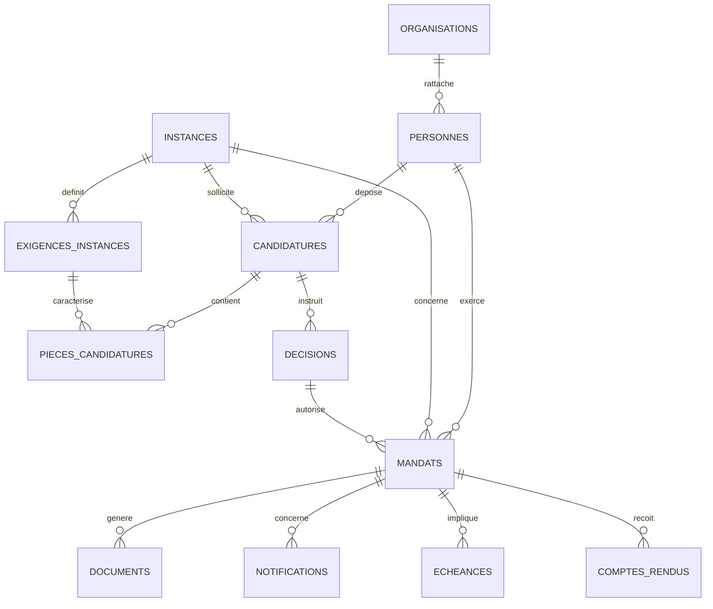

# Modèle de données — CFTC Mandats Paritaires

**Version de conception : 0.3 — 25 octobre 2026.** Ce document distingue les tables effectivement manipulées par les branches US-001/US-002 des futures entités métier. Les noms de colonnes des tableaux actuels reproduisent les contrats du code ; les entités futures sont **proposées**, non déployées.

## Vue relationnelle conceptuelle

**Attention :** les cardinalités au-delà des tables US-001/US-002 sont des hypothèses de conception à confirmer. Un même mandat peut nécessiter plusieurs décisions (désignation, renouvellement, cessation) ; le futur modèle devra gérer ces événements plutôt que les écraser.

## A. Tables et contrats déjà présents dans le code de développement

| Table | Clé technique | Colonnes, dans l'ordre actuellement attendu | Origine |
| --- | --- | --- | --- |
| `Personnes` | `PERSONNE_ID` | `PERSONNE_ID`, `Nom`, `Prénom`, `Courriel`, `Syndicat_ID`, `UD_ID`, `Créé_le` | `src/Config.gs`, US-001 |
| `Candidatures` | `CAND_ID` | `CAND_ID`, `PERSONNE_ID`, `Source`, `Source_ID`, `Instance_ID`, `Date_réception`, `Statut`, `Créé_le` | `src/Config.gs`, US-001 |
| `Audit_Imports` | **Aucune clé dédiée à ce stade** | `Date`, `Action`, `Source_ID`, `Résultat`, `Détails` | `src/Config.gs`, US-001 |
| `Instances` | `INSTANCE_ID` | `INSTANCE_ID`, `Nom`, `Type`, `Actif`, `Validation_metier` | `src/InstanceRegistry.gs`, US-002 |
| `Exigences_instances` | composée `INSTANCE_ID` + `Document_code` | `INSTANCE_ID`, `Document_code`, `Document_libelle`, `Obligatoire`, `Validation_metier` | `src/InstanceRequirements.gs`, US-002 |
| `Pieces_candidatures` | composée `CAND_ID` + `Document_code` | `CAND_ID`, `Document_code`, `Drive_file_ID`, `Controle`, `Validation_metier` | `src/DocumentEvidence.gs`, US-002 |

### Particularités du stockage actuel

- US-001 crée des identifiants techniques UUID pour les personnes et les candidatures. `Source_ID` est actuellement une empreinte SHA-256 calculée depuis des données de réponse, **pas** un identifiant natif Forms immuable.
- US-001 laisse actuellement `Instance_ID` vide tant que le rapprochement entre les réponses Forms et le référentiel d'instances n'est pas réalisé. Ne pas inventer cette correspondance.
- Dans `Instances`, `Actif` et `Validation_metier` acceptent la valeur **oui** pour activer la validation ; un autre état ne permet pas le rapprochement.
- Les indicateurs `Obligatoire` et `Validation_metier` des exigences documentaires acceptent **oui** ou **non** ; les valeurs ambiguës sont rejetées.
- `Pieces_candidatures.Controle` accepte `present`, `absent` ou `a_verifier` ; `Validation_metier` accepte `oui` ou `non`. La présence d'un `Drive_file_ID` ne suffit pas à attester une pièce.
- Le contrôle technique Drive nécessite une autorisation explicite **en test**, encore non homologuée. Le contenu des fichiers n'est pas lu.

## B. Entités métier cibles, non encore implémentées

| Entité future | Identifiant proposé | Champs de cadrage proposés | Règle métier à valider |
| --- | --- | --- | --- |
| `Organisations` | `ORG_ID` | type (syndicat/UD/confédération/partenaire), nom, territoire, coordonnées | référentiel officiel et habilitations |
| `Decisions` | `DECISION_ID` | `CAND_ID`, autorité, date, référence de PV, résultat, preuve de validation | aucune désignation sans décision compétente |
| `Mandats` | `MANDAT_ID` | `PERSONNE_ID`, `INSTANCE_ID`, décision de désignation, fonction, début, fin, état | historique des mandats et renouvellements |
| `Documents` | `DOCUMENT_ID` | objet rattaché, type, modèle, version, référence Drive, statut, auteur | distinguer brouillon/validé/officiel |
| `Notifications` | `NOTIF_ID` | objet, destinataire, type, brouillon Gmail, date, validation, envoi | aucun envoi automatique par défaut |
| `Echeances` | `ECHEANCE_ID` | mandat, nature, date, propriétaire, rappel, état | règles calendaires et responsabilités |
| `Comptes_rendus` | `CR_ID` | mandat, séance, auteur, référence Drive, réception, validation | accès et conservation |
| `Journal_metier` | `EVENT_ID` | acteur technique, action, type d'objet, ID d'objet, horodatage, résultat | preuve et audit minimisé |

**Ces colonnes sont des propositions d'architecture**, et non un état constaté du classeur Bretagne. Elles devront être arbitrées par les responsables métier avant toute création ou migration.

## C. Relations, intégrité et invariants

1. `Candidatures.PERSONNE_ID` doit désigner une unique ligne de `Personnes`. Une personne peut déposer plusieurs candidatures ; une candidature ne doit pas être réattribuée automatiquement par simple homonymie.
2. `Candidatures.Instance_ID`, lorsqu'il est renseigné, doit correspondre à une instance **active et validée** avant de permettre le diagnostic `PRET_A_INSTRUIRE`.
3. `Exigences_instances` est identifié par le couple `INSTANCE_ID` + `Document_code`; `Pieces_candidatures` par `CAND_ID` + `Document_code`. Les doublons sont rejetés.
4. Toute référence documentaire doit pointer vers un `CAND_ID` existant. Une pièce n'est considérée attestée que si le métier l'a validée et si le contrôle technique autorisé réussit ; l'existence du fichier **ne démontre pas** son authenticité ou son bon titulaire.
5. Aucun diagnostic de complétude ne vaut décision officielle, désignation ou notification.
6. Les clés techniques sont indépendantes des noms affichés. Le courriel est utilisé aujourd'hui pour détecter des personnes déjà présentes, mais **ne constitue pas une clé métier immuable**.
7. Les suppressions de dossiers, la fusion des personnes, les changements de statut et les migrations doivent être explicitement autorisés, tracés et testés.
8. Le référentiel est manipulé via des adaptateurs : les fonctions de domaine sont indépendantes de Google Sheets, Google Drive et Gmail.

## D. Statuts à ne pas confondre

| Domaine | Valeurs actuellement définies ou proposées | Nature |
| --- | --- | --- |
| Import US-001 | `IMPORT`, `IGNORE`, `REJET` | décisions techniques d'import |
| Diagnostic US-002 | `INCOMPLET`, `A_VERIFIER`, `PRET_A_INSTRUIRE`, `ANOMALIE_REFERENTIEL` | diagnostic, pas décision officielle |
| Candidature US-001 | `Candidature reçue` | valeur initiale de la table `Candidatures` |
| Décision de mandatement | nomenclature **à valider** (US-003/004) | événement juridico-organisationnel |
| Mandat officiel | nomenclature **à valider** | cycle de vie organisationnel |

## E. Gouvernance et évolution du schéma

- **Versionner le schéma** : identifier les versions des tables et écrire des scripts de migration idempotents pour toute modification de colonnes ou de relations.
- **Ne pas casser les importations existantes** : compatibilité ascendante, tests de migration et stratégie de retour arrière.
- **Établir les sources de vérité** : réponse Forms, référentiel central, documents Drive, PV validés et correspondances doivent avoir un propriétaire explicite.
- **Contrôler les habilitations** : le dépôt GitHub est public, mais les données nominatives, les IDs de fichiers sensibles et les justificatifs restent dans les espaces autorisés.
- **Conserver un audit utile et proportionné** : l'actuel `Audit_Imports` est technique et n'est pas encore un journal métier inviolable.
- **Recetter sur environnement TEST** avant fusion et tout déploiement ; ne pas publier d'export réel dans GitHub.

## F. Points ouverts avant mise en production

- Identifiant de réponse Forms réellement immuable, correspondance et reprise après modification.
- Nomenclature officielle des instances et correspondance depuis la candidature Forms.
- Définition de la décision compétente, de ses références et de ses preuves.
- Cardinalités des décisions, mandats multiples et renouvellements.
- Champs spécifiques par organisme, justificatifs obligatoires et conservation.
- Habilitations et portée OAuth minimale des outils Workspace.
- Réconciliation des historiques existants et stratégie de migration.

**Références :** [README / cahier des charges](../README.md), [architecture](ARCHITECTURE.md), [US-001](US-001-INSTALLATION.md), [US-002](US-002-COMPLETUDE.md).
